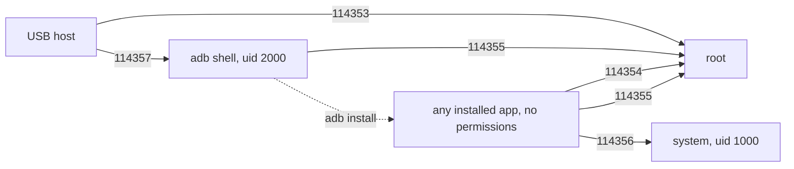

# DJI CrystalSky CVE PoCs

Proof-of-concept code for five vulnerabilities in the DJI CrystalSky ZS600C
(Rockchip RK3288, Android 5.1.1), disclosed 2026-10.

| CVE | Issue | CVSS | 
|---|---|---|
| [CVE-2026-114353](cves/CVE-2026-114353/) | Hard-coded token on the USB serial port gives a root shell (`assistant`) | 7 |
| [CVE-2026-114354](cves/CVE-2026-114354/) | Binder transaction 1018 of `android.dji.server` runs commands as root | 8.6 | 
| [CVE-2026-114355](cves/CVE-2026-114355/) | Command injection via logcat in the root script `hardware_monitor.sh` | 8.4 | 
| [CVE-2026-114356](cves/CVE-2026-114356/) | `DJIUpdateService` (uid system) accepts transactions from any app | 7.7 | 
| [CVE-2026-114357](cves/CVE-2026-114357/) | adb enabled over USB with authentication disabled | 6.8 |

## Attack paths


Anyone with a USB cable gets a shell (114357) or root (114353). Any app on the
device, including one with no permissions, gets root (114354, 114355) or
system-uid actions (114356).

Three platform properties make this reachable:

- SELinux is not compiled into the kernel (`getenforce` → `Disabled`), so the
  property service lets any uid write `ctl.start`.
- No dm-verity; `/system` is plain ext4.
- `ro.adb.secure=0` and `persist.sys.usb.config=mass_storage,adb,acm`.

## Tested on

CrystalSky ZS600C, Android 5.1.1, kernel Linux 3.10.0 (`dji@RDCMP33-in`,
built 2018-06-27). Other firmware versions and the ZS600A share the same
`/system` image as far as we know, but were not tested.

## Running the PoCs

`./check-device.sh` prints the model, firmware and the platform properties above.
Each CVE directory has a README with usage and cleanup. The payloads only run
`id` and write the output to a file under `/data/local/tmp`.

The prebuilt `poc.apk` files can be rebuilt from source:

```sh
export ANDROID_JAR=$ANDROID_HOME/platforms/android-29/android.jar
./build-apk.sh cves/CVE-2026-114354
```
