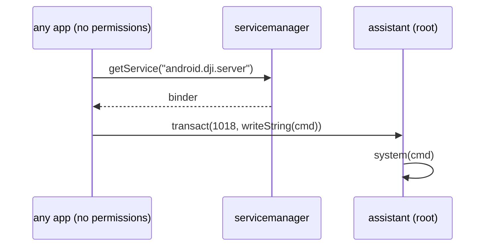

# CVE-2026-114354: root command execution through `android.dji.server`

**CWE-78 · CVSS 8.6**

## Summary

`/system/bin/assistant` runs as root from `init.rc` (no `user` line, and it
never drops privileges) and registers the global binder service
`android.dji.server`. Its `onTransact` handles 24 transaction codes and checks
neither the interface token nor the caller's uid.

Transaction 1018 (`0x3FA`) runs its argument as a shell command:

```c
s = String8(data.readString16());
__android_log_print(ANDROID_LOG_DEBUG, "assistant AssistantServer.cpp", "IPTABLES_CMD %s", s);
system(s);
```

Any installed app, with no permissions and signed with any key, can run
commands as root with a single `transact()` call.



## PoC

```sh
./poc.sh
# -rw-rw-rw- root root /data/local/tmp/cve-2026-114354
# uid=0(root) gid=0(root)

# D/assistant AssistantServer.cpp( ...): IPTABLES_CMD id > /data/local/tmp/cve-2026-114354 2>&1; chmod 666 ...
```

The app ([src/poc/Poc.java](src/poc/Poc.java)) writes the output of `id` to
`/data/local/tmp/cve-2026-114354`. 

Another command can be passed with
`adb shell am start -n poc.cve114354/poc.Poc --es cmd '...'`.

## Notes

`adb shell service call android.dji.server 1018 s16 'id'` does **not** work.
The `service` tool always writes an interface token first, and `assistant`
reads the string from offset 0, so it reads the token header as the string
length and gets an empty string. The daemon logs an empty `IPTABLES_CMD`
line, which shows the service is reachable, but nothing runs. The app writes
the string without a token.

Other transactions on the same interface that need no authentication either
(not automated here):

| code | effect |
|---|---|
| 204 | firmware update: flashes `parameter`, `uboot`, `boot`, `recovery`, `system` without a signature check |
| 1015 | sets the radio link frequency |
| 1017 | deletes DeviceTest and Music from `/system/app` and `/data`, leaves `/system` rw, reboots |
| 1020 | an integer of 7+ digits overflows an 8-byte `__sprintf_chk` buffer and aborts the daemon |
| 2000 | fan control and `ctl.stop`/`ctl.start istd8303` |
