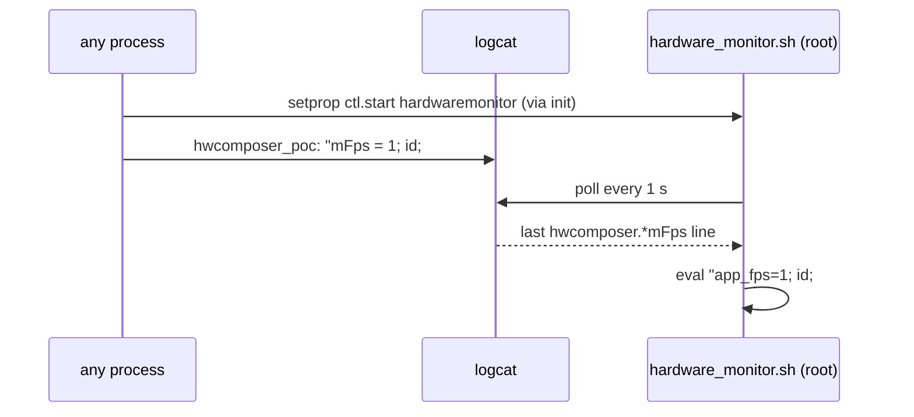

# CVE-2026-114355: root command injection through logcat in `hardware_monitor.sh`

**CWE-78 · CVSS 8.6**

## Summary

The init service `hardwaremonitor` runs `/system/bin/hardware_monitor.sh` as
root. It is `disabled` in `init.rc`, but any UID can start it with
`setprop ctl.start hardwaremonitor` because SELinux is not compiled into the
kernel.

The script passes `logcat` output to `eval` in six places (lines 325, 340,
355, 367, 388, 403). Every second it takes the last logcat line matching
`hwcomposer.*mFps`, turns the text after `mFps = ` into `app_fps=<text>;` and
evals it as shell code. Writing to logcat needs no permission on Android 5.1.1, so any process,
including an app with no permissions, can run commands as root.



## PoC

```sh
./poc.sh
# running
# -rw-rw-rw- root root ... cve-2026-114355
# uid=0(root) gid=0(root)
```

`poc.sh` starts the service, logs 60 lines whose payload writes the output of
`id` to `/data/local/tmp/cve-2026-114355`, reads it back, then stops the
service and removes the file.

`./poc.sh app` does the same from a zero-permission app
([src/poc/Poc.java](src/poc/Poc.java)): `SystemProperties.set("ctl.start", …)`
through reflection, then the burst with `Log.i`. It uses the same two
primitives as the shell path, but has not been run on a device.

## Notes

This is command execution, not a shell: each injected line runs once, and
output only comes back by redirecting it to a file and reading that over adb.

The PoC sends a burst because `awk END{}` keeps only the last matching line
per poll, and the script sets `debug.hwc.logfps=1`, so the real hwcomposer
logs `mFps` lines too. A single line can lose that race.

If `init.svc.hardwaremonitor` stays `stopped`, the `ctl.start` write was
refused. Check `adb shell getenforce`; on the tested unit it is `Disabled`.
