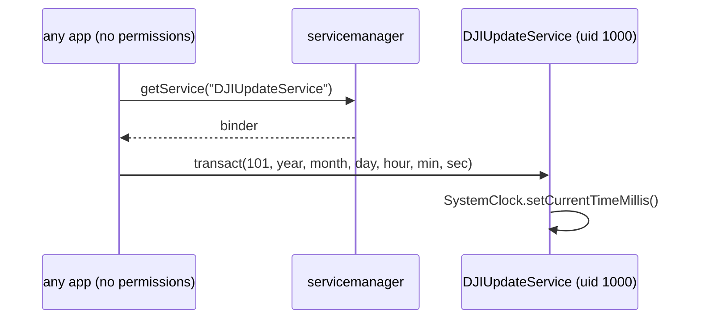

# CVE-2026-114356: `DJIUpdateService` (uid system) accepts transactions from any app

**CWE-862 · CVSS 7** · [CVE record](https://www.cve.org/CVERecord?id=CVE-2026-114356)

## Summary

`android.rockchip.update.service` runs as `sharedUserId android.uid.system`
(uid 1000) and registers the global binder `DJIUpdateService` with
`ServiceManager.addService()`. `RKUpdateService$LocalBinder.onTransact` does
not check the caller: there are no calls to `checkCallingPermission`,
`checkCallingOrSelfPermission`, `enforceCallingPermission`, `getCallingUid`
or `getCallingPid` in any of its 83 classes, and no interface token is read.

Any installed app, with no permissions and signed with any key, can get the
binder with `ServiceManager.getService("DJIUpdateService")` and call it. The
handler reads arguments with bare `readInt()` / `readString()` and never calls
`enforceInterface()`, so a caller must not write a token; one would shift
every field.

| code | effect |
|---|---|
| 101 | `Calendar.set` + `SystemClock.setCurrentTimeMillis` (month 0-based) |
| 105 | `send_shutdown_action()`: `ACTION_REQUEST_SHUTDOWN` with `KEY_CONFIRM=false`, no dialog |
| 122 | `Common.get_active_flag()`: `File.exists()` on `/metadata/active_flag.bin` |
| 123 | `AlarmManager.setTimeZone(<caller string>)` |
| 124 | sets the device-wide locale; a wrong value can make the UI unreadable |
| 151 | firmware update: `UpdateAndRebootActivity` → `RecoverySystem.installPackage` / `installRKimage` → `/cache/recovery/command` → reboot to recovery, flashing `parameter`, `uboot`, `boot`, `recovery`, `system`. The only check, `doesOtaPackageMatchProduct()`, is stubbed `return true`. A bad image bricks the device. |
| 153 | `FORMAT_AND_FACTORY_RESET` through `ExternalStorageFormatter`: wipes all data including external storage, no arguments, no confirmation |

151 and 153 are documented here, not automated.



## PoC

Expected output:

```sh
./poc.sh
# Mon Oct 26 14:00:00 CET 2026
# I/CVE-2026-114356( ...): clock jumped 300 s
# I/CVE-2026-114356( ...): restored, off by ... ms
# ... DJIService assistant( ...): djisync_time 2026 9 26 14 5 1
# ... DJIService assistant( ...): djisync_time 2026 9 26 14 0 2
# Mon Oct 26 14:00:03 CET 2026
```

The app ([src/poc/Poc.java](src/poc/Poc.java)) records the wall clock and
`elapsedRealtime()`, sends transaction 101 to move the clock 5 minutes
forward, measures the jump against `elapsedRealtime()`, then sets it back to
the recorded time plus the time that has passed. `Calendar.set()` has no
milliseconds field, so the restore is accurate to about a second.

## Notes

The missing caller check comes from static analysis of
`RKUpdateService$LocalBinder.onTransact`. That an app can reach the service is
predicted (it runs in a `system_app` domain, and app → `system_app` binder
calls are allowed by standard policy), not observed.

`transact()` returns `false` even when the call worked: codes 101, 105, 106,
151 and 153 act and then fall through to `super.onTransact`.

The month is 0-based: the handler passes it straight to `Calendar.set()`. The
PoC sends `Calendar.MONTH` unchanged; a caller that adds 1 lands a month late.

`adb shell service call DJIUpdateService …` prints `Service DJIUpdateService
does not exist`, although `service check` finds it. The binder has no
`attachInterface()`, so its descriptor is empty, and the `service` tool gives
up on an empty descriptor. That is a tool limitation, not a guard.
