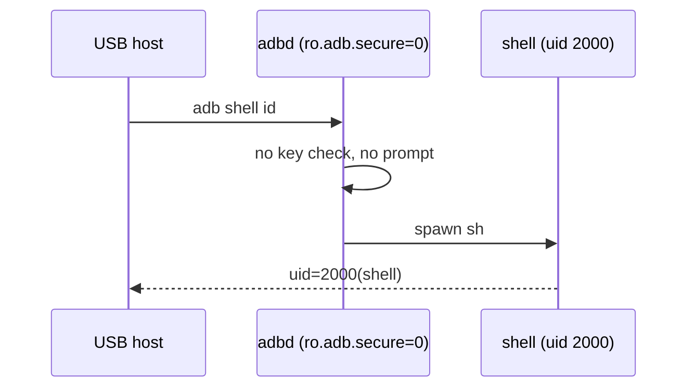

# CVE-2026-114357: adb over USB with authentication disabled

**CWE-306 · CVSS 7 (AV:P)**

## Summary

`ro.adb.secure=0` turns off adb key authorization, so adb is unauthenticated
on whatever transport it is exposed on.

USB adb is on by default (`persist.sys.usb.config=mass_storage,adb,acm`). Any
USB host gets a shell as uid 2000 with no prompt.

adb over TCP (port 5555) is not on by default: no prop file or init `.rc` sets
`persist.adb.tcp.port` or `service.adb.tcp.port`. It can be turned on by an
operator, by the shipped `/system/bin/adbd_tcp.sh`, or by anyone with a shell
running `setprop persist.adb.tcp.port 5555`, and is then unauthenticated too.



## PoC

```sh
./poc.sh
# uid=2000(shell) gid=2000(shell) groups=...
# 0
# mass_storage,adb,acm
```

`poc.sh` is read-only: it runs `id` and reads `ro.adb.secure` and
`persist.sys.usb.config`.

## Notes

The shell is uid 2000. Root needs CVE-2026-114355 or CVE-2026-114354 on top.

`persist.adb.tcp.port=5555` on the tested unit was set during testing
(`adb tcpip 5555`); it is not factory state.
